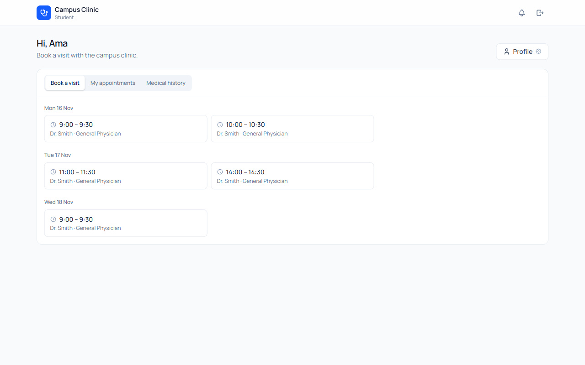
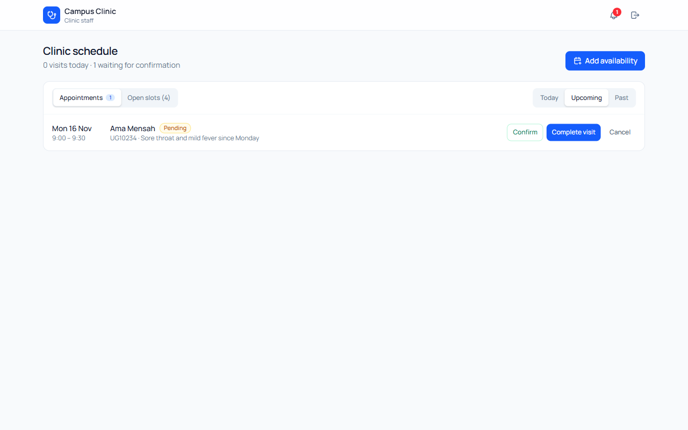
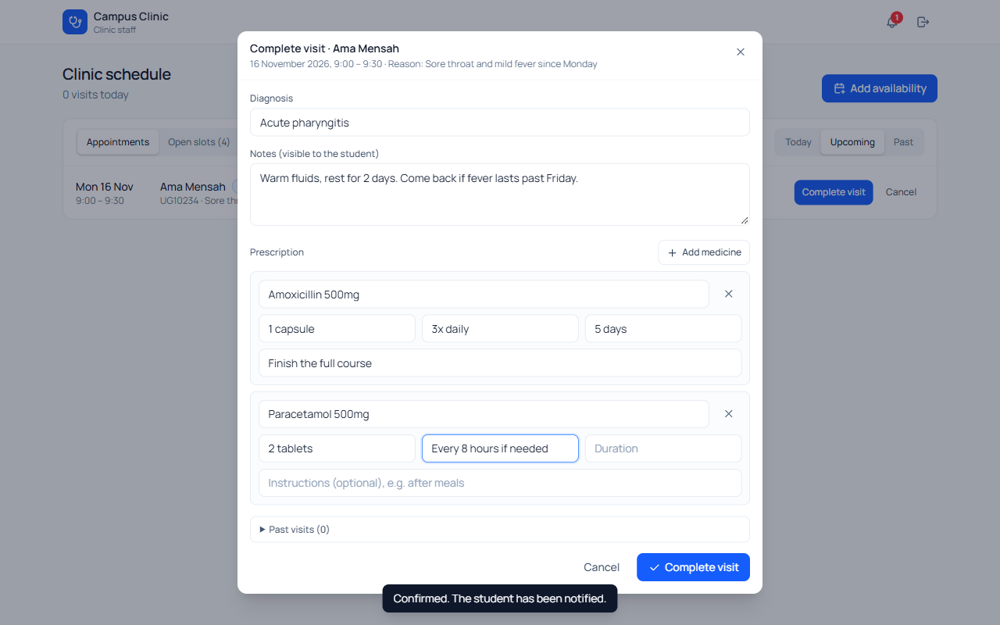
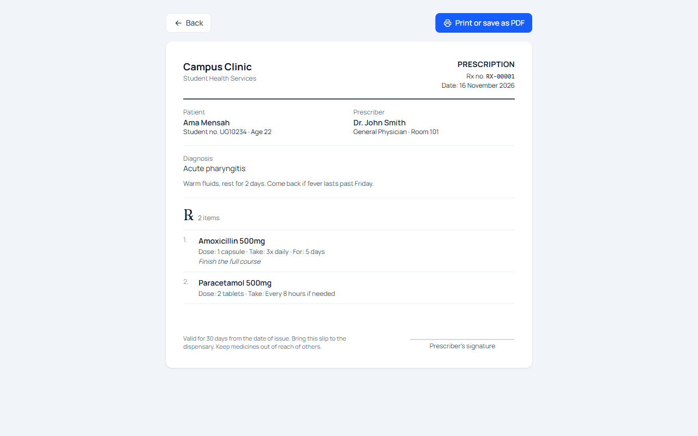

# Campus Clinic

A web app for a school or university clinic. Students book visits, clinic staff run their schedule and write visit notes and prescriptions, and administrators see how the clinic is being used.

Built with **React 19 + Vite + Tailwind 4** on the front end and **Node.js (Express 5) + MySQL 8** on the back end.

| Student booking | Staff schedule |
|---|---|
|  |  |
| **Completing a visit with a prescription** | **Printable prescription** |
|  |  |

## What it does

**Students**
- Create an account and book an open time slot, with a short reason for the visit
- See upcoming and past appointments, and cancel one (the slot goes back on offer)
- Read their medical history: diagnosis, doctor's notes and itemised prescriptions
- Print or save any prescription as a PDF
- Get notified when a visit is confirmed, cancelled, or the notes are ready

**Clinic staff**
- Publish availability in a few clicks (the form moves on to the next block after each slot)
- Confirm or cancel requests; the student is notified either way
- Complete a visit: diagnosis, notes and several medicines (dose, frequency, duration, instructions), with the student's past visits shown alongside
- Filter appointments by today, upcoming and past

**Administrators**
- See student, staff and appointment totals, visits per day (the past week and bookings ahead), and a breakdown by status
- Add staff accounts and see the staff list

## Security

- Every route checks the caller's **role**, and every change checks **ownership**: a doctor can only act on their own appointments, and a student can only see their own records.
- Double booking is blocked in the database by a unique key on *active* appointments, and booking locks the slot row.
- Passwords are hashed with bcrypt. JWTs are signed with HS256, and the server refuses to start unless `JWT_SECRET` is at least 32 characters. Login and registration are rate limited.
- Input is validated on every write. Error responses never include internal details. Helmet headers are set, and CORS only allows origins you list.
- There are no built-in default passwords. The first admin is created from environment variables.

## Project layout

```
backend/    Express API (routes -> middleware -> controllers), schema.sql, tests
frontend/   React app (pages, shared UI kit in src/components)
docs/       Screenshots, plus the original AWS coursework docs
render.yaml One-click API deployment on Render
```

## Run it locally

You need **Node.js 22+** and **MySQL 8**. MySQL can be XAMPP, a local install, or Docker:

```bash
docker run -d --name clinic-mysql -e MYSQL_ROOT_PASSWORD=devroot -e MYSQL_DATABASE=schoolclinic_db -p 3307:3306 mysql:8.4
```

**Backend**

```bash
cd backend
npm install
cp .env.example .env       # then fill it in (see below)
npm run db:setup           # creates the tables (safe to re-run)
npm run seed:demo          # optional: one demo doctor with open slots
npm start                  # http://localhost:5000
```

The minimum `.env` for the Docker database above:

```env
DB_HOST=127.0.0.1
DB_PORT=3307
DB_PASSWORD=devroot
DB_NAME=schoolclinic_db
JWT_SECRET=<run: node -e "console.log(require('crypto').randomBytes(48).toString('hex'))">
DEFAULT_ADMIN_EMAIL=you@example.com
DEFAULT_ADMIN_PASSWORD=<12+ characters>
```

**Frontend** (in a second terminal)

```bash
cd frontend
npm install
npm run dev                # http://localhost:5173
```

Sign in with the admin account from your `.env`, then add a staff member. Use **Create an account** on the login page to try the student side.

## Tests

`backend/test/api.test.js` runs 18 integration tests against a real MySQL database. They cover authentication, role checks, ownership checks, double booking, re-booking after a cancellation, prescriptions and validation. The tests create and drop their own `clinic_test` database.

```bash
cd backend
npm test        # expects MySQL on 127.0.0.1:3307 (root/devroot); override with TEST_DB_HOST/PORT/USER/PASSWORD
```

GitHub Actions runs these tests, plus the frontend lint and build, on every push.

## API

All routes are under `/api`. Every route except auth needs `Authorization: Bearer <token>`.

| Method | Path | Who | Purpose |
|---|---|---|---|
| POST | `/auth/register` | public | Student sign-up |
| POST | `/auth/login` | public | Returns a JWT |
| GET | `/appointments/slots` | student | Open upcoming slots |
| POST | `/appointments/book` | student | Book `{ slotId, reason }` |
| GET | `/appointments/me` | student | Own appointments |
| PUT | `/appointments/:id/cancel` | student | Cancel own appointment |
| GET | `/appointments/staff` | staff | Own appointments |
| GET / POST | `/appointments/staff/slots` | staff | List or add open slots |
| DELETE | `/appointments/staff/slots/:id` | staff | Remove an open slot |
| PUT | `/appointments/:id/confirm` | staff | Confirm a request |
| PUT | `/appointments/:id/cancel-by-staff` | staff | Cancel (the slot stays closed) |
| POST | `/records` | staff | Complete a visit: diagnosis, notes, `prescriptions[]` |
| GET | `/records/me` | student | Own medical history |
| GET | `/records/student/:studentId` | staff | A student's history |
| GET | `/records/:id` | student (own) / staff | One record, used for printing |
| GET / PUT | `/students/me` | student | Profile, phone number |
| GET | `/notifications/me` | any | Latest 50 notifications |
| PUT | `/notifications/:id/read`, `/notifications/read-all` | any | Mark as read |
| GET | `/admin/stats`, `/admin/staff` | admin | Dashboard data, staff list |
| POST | `/admin/staff` | admin | Add a staff account |
| POST | `/upload/profile-picture` | any | S3 upload (returns 503 if S3 is not configured) |
| GET | `/health` | public | Checks the database connection |

## Deploying

See [DEPLOYMENT.md](DEPLOYMENT.md). It runs for free on Vercel (frontend), Render (API) and Aiven (MySQL). The original AWS EC2/RDS guide is in [docs/DEPLOYMENT_AWS.md](docs/DEPLOYMENT_AWS.md).

## History

This repository merges three earlier versions of the project. `clinic-appointment` was an earlier copy of this app. `CLINIC` was a Java/Spring version for a general clinic, and its printable prescription layout was ported here.
