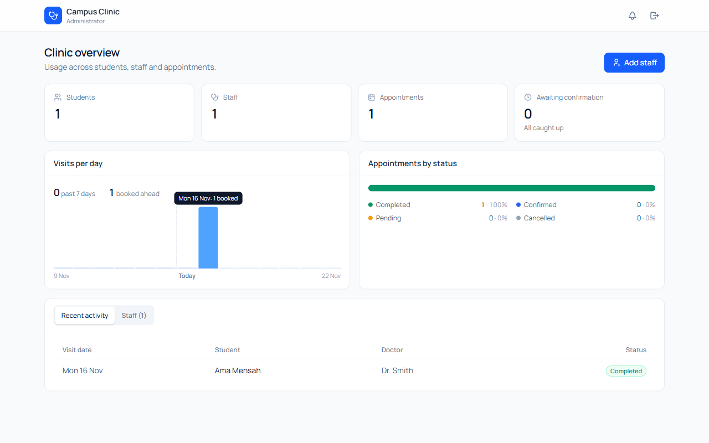
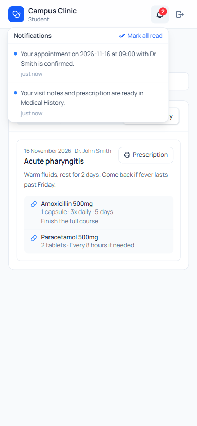
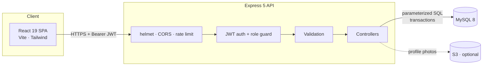
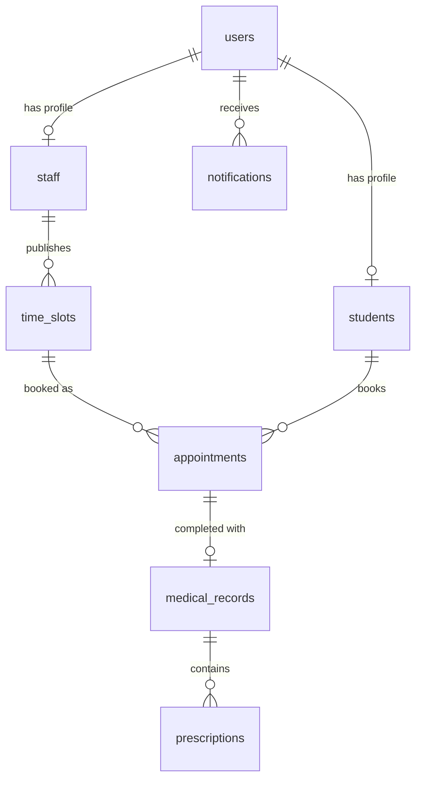

<div align="center">

# Campus Clinic

**Appointment booking, visit records and prescriptions for school and university clinics.**

[](https://github.com/ohenemanaf/school-clinic-system/actions/workflows/ci.yml)


[](LICENSE)

[Features](#features) · [Screenshots](#screenshots) · [Architecture](#architecture) · [Getting started](#getting-started) · [API](#api-reference) · [Deployment](#deployment)

</div>

---

## Overview

Campus Clinic replaces paper sign-up sheets and walk-in queues with one web app that serves three roles:

- **Students** book a visit online and see their own records.
- **Clinic staff** manage their availability and record each visit, including prescriptions.
- **Administrators** add staff and see how the clinic is being used.

Access control is checked on the server for every request, and every rule is covered by integration tests that run against a real MySQL database in CI.

## Features

| Students | Clinic staff | Administrators |
|---|---|---|
| Register and book any open slot | Publish availability in a few clicks | Totals for students, staff and appointments |
| View, track and cancel appointments | Confirm or cancel requests (the student is notified) | Visits per day: the past week and bookings ahead |
| Medical history with diagnoses and notes | Complete a visit with diagnosis, notes and several medicines | Appointment breakdown by status |
| Print or save prescriptions as PDF | See the student's past visits during the consultation | Add staff accounts and view the staff list |
| In-app notifications | Filter appointments by today, upcoming and past | Recent activity feed |

**Across the app:** a responsive layout that works on phones, printable prescriptions, sessions that expire and send the user back to login, and code split by role so each user only downloads the code for their own portal.

## Screenshots

| Student: booking | Staff: schedule |
|---|---|
|  |  |
| **Staff: completing a visit** | **Printable prescription** |
|  |  |
| **Admin: overview** | **Mobile: medical history** |
|  |  |

## Architecture



<details>
<summary><b>Data model</b></summary>



`appointments.active_slot_id` is a stored generated column with a unique index. It holds the slot only while the appointment is not cancelled, so the database itself prevents two active bookings on one slot, while a slot freed by a cancellation can be booked again.

</details>

### Tech stack

| Layer | Technology |
|---|---|
| Frontend | React 19, React Router 7, Vite 8, Tailwind CSS 4, Tabler Icons, Axios |
| Backend | Node.js 22, Express 5, mysql2, jsonwebtoken, bcryptjs, helmet, express-rate-limit, multer |
| Database | MySQL 8 (TLS supported for managed providers) |
| Testing & CI | `node:test` + Supertest against MySQL, oxlint, GitHub Actions |
| Hosting | Vercel (frontend), Render (API), Aiven (MySQL) |

## Security

| Concern | How it is handled |
|---|---|
| Authorization | Every route requires a role (`student`, `staff`, `admin`). Every change also checks ownership: staff can only act on their own appointments, and students can only read their own records. |
| Booking races | The slot row is locked with `SELECT … FOR UPDATE`, and a unique index on active appointments blocks double booking at the database level. |
| Credentials | Passwords are hashed with bcrypt. Tokens are HS256 JWTs. The server will not start unless `JWT_SECRET` is at least 32 characters. There are no default passwords. |
| Brute force | Login and registration are rate limited per IP. |
| Input | Every write is validated and trimmed (passwords are not trimmed). All SQL is parameterized. |
| Information leakage | One central error handler logs details on the server and returns safe messages to the client. |
| Transport & headers | Helmet sets security headers. CORS allows only the origins you list. The database connection can use TLS with your provider's CA certificate. |
| Uploads | Images only (JPG, PNG, WebP), up to 2 MB. The file extension comes from the checked file type, never from the uploaded filename. |

## Getting started

### Prerequisites

- Node.js **22+**
- MySQL **8**: a local install, XAMPP, or Docker:

  ```bash
  docker run -d --name clinic-mysql -e MYSQL_ROOT_PASSWORD=devroot \
    -e MYSQL_DATABASE=schoolclinic_db -p 3307:3306 mysql:8.4
  ```

### 1. Backend

```bash
cd backend
npm install
cp .env.example .env     # fill in the values below
npm run db:setup         # create tables (idempotent)
npm run seed:demo        # optional: a demo doctor with open slots
npm start                # http://localhost:5000
```

### 2. Frontend

```bash
cd frontend
npm install
npm run dev              # http://localhost:5173
```

Sign in with the admin account from your `.env` and add a staff member. Use **Create an account** on the login page to try the student side.

### Environment variables

<details>
<summary><b>backend/.env</b></summary>

| Variable | Required | Description |
|---|:---:|---|
| `DB_HOST`, `DB_PORT`, `DB_USER`, `DB_PASSWORD`, `DB_NAME` | ✓ | MySQL connection |
| `DB_SSL_CA` | | CA certificate (PEM) for managed MySQL such as Aiven |
| `JWT_SECRET` | ✓ | 32+ characters. Generate one with `node -e "console.log(require('crypto').randomBytes(48).toString('hex'))"` |
| `JWT_EXPIRES_IN` | | Session length. Default `2h` |
| `DEFAULT_ADMIN_EMAIL`, `DEFAULT_ADMIN_PASSWORD` | | Creates the first admin on startup (password 12+ characters) |
| `CORS_ORIGIN` | | Allowed frontend origins, comma-separated. Default `http://localhost:5173` |
| `TRUST_PROXY` | | Set to `1` behind a proxy (Render, Nginx) |
| `AUTH_RATE_LIMIT` | | Login/registration attempts per 15 minutes. Default `20` |
| `AWS_REGION`, `AWS_S3_BUCKET_NAME`, `AWS_S3_PUBLIC_URL` | | Optional profile-photo storage |

</details>

<details>
<summary><b>frontend/.env</b></summary>

| Variable | Description |
|---|---|
| `VITE_API_URL` | API base URL, including `/api` |
| `VITE_CLINIC_NAME`, `VITE_CLINIC_ADDRESS` | Shown on printed prescriptions |

</details>

### Scripts

| Location | Command | Purpose |
|---|---|---|
| `backend` | `npm start` | Start the API |
| `backend` | `npm run db:setup` | Create tables and run migrations |
| `backend` | `npm run seed:demo` | Add a demo doctor and slots (refused in production unless `ALLOW_SEED=true`) |
| `backend` | `npm test` | Run the integration tests |
| `frontend` | `npm run dev` / `build` / `lint` | Dev server, production build, lint |

## Testing

The backend suite (`backend/test/api.test.js`) runs **18 integration tests** against a real MySQL instance. It creates and drops its own `clinic_test` database. The tests cover:

- authentication, validation, and duplicate or forged credentials
- role enforcement on every protected route
- ownership: users can't touch other users' appointments, records or notifications
- double-booking prevention and re-booking a slot after a cancellation
- completing a visit with prescriptions, including validation of each medicine

```bash
cd backend
npm test   # expects MySQL on 127.0.0.1:3307; override with TEST_DB_HOST / TEST_DB_PORT / TEST_DB_USER / TEST_DB_PASSWORD
```

GitHub Actions runs the backend suite against MySQL 8.4, plus the frontend lint and build, on every push and pull request.

## API reference

Base path `/api`. Every route except `auth` and `health` needs an `Authorization: Bearer <token>` header.

<details>
<summary><b>Auth & profile</b></summary>

| Method | Endpoint | Role | Description |
|---|---|---|---|
| `POST` | `/auth/register` | public | Student sign-up |
| `POST` | `/auth/login` | public | Returns `{ token, role, userId }` |
| `GET` | `/students/me` | student | Profile |
| `PUT` | `/students/me` | student | Update phone number |
| `POST` | `/upload/profile-picture` | any | Profile photo (returns 503 if storage is not configured) |

</details>

<details>
<summary><b>Appointments</b></summary>

| Method | Endpoint | Role | Description |
|---|---|---|---|
| `GET` | `/appointments/slots` | student | Open upcoming slots |
| `POST` | `/appointments/book` | student | Book `{ slotId, reason }` |
| `GET` | `/appointments/me` | student | Own appointments |
| `PUT` | `/appointments/:id/cancel` | student | Cancel and release the slot |
| `GET` | `/appointments/staff` | staff | Own appointments |
| `GET` | `/appointments/staff/slots` | staff | Own open slots |
| `POST` | `/appointments/staff/slots` | staff | Add a slot `{ slotDate, startTime, endTime }` |
| `DELETE` | `/appointments/staff/slots/:id` | staff | Remove an open slot |
| `PUT` | `/appointments/:id/confirm` | staff | Confirm a pending request |
| `PUT` | `/appointments/:id/cancel-by-staff` | staff | Cancel (the slot stays closed) |

</details>

<details>
<summary><b>Records & prescriptions</b></summary>

| Method | Endpoint | Role | Description |
|---|---|---|---|
| `POST` | `/records` | staff | Complete a visit: `{ appointmentId, diagnosis, notes?, prescriptions?[] }` |
| `GET` | `/records/me` | student | Own medical history |
| `GET` | `/records/student/:studentId` | staff | A student's history |
| `GET` | `/records/:id` | student (own) · staff | One record, used for printing |

Each `prescriptions[]` item has the shape `{ medicineName, dosage?, frequency?, duration?, instructions? }`, with up to 10 items per visit.

</details>

<details>
<summary><b>Notifications, admin & health</b></summary>

| Method | Endpoint | Role | Description |
|---|---|---|---|
| `GET` | `/notifications/me` | any | Latest 50 notifications |
| `PUT` | `/notifications/:id/read` | any | Mark one as read |
| `PUT` | `/notifications/read-all` | any | Mark all as read |
| `GET` | `/admin/stats` | admin | Dashboard metrics |
| `GET` | `/admin/staff` | admin | Staff list |
| `POST` | `/admin/staff` | admin | Create a staff account |
| `GET` | `/health` | public | Checks the database connection |

</details>

## Project structure

```
school-clinic-system/
├── backend/
│   ├── config/          # MySQL pool (with optional TLS)
│   ├── controllers/     # Request handlers
│   ├── middleware/      # Auth, role guards, validation
│   ├── routes/          # Route definitions per resource
│   ├── services/        # First-admin bootstrap
│   ├── test/            # Integration tests
│   ├── schema.sql       # Database schema
│   ├── setup-db.js      # Applies the schema and migrations
│   └── server.js        # App setup and error handling
├── frontend/
│   └── src/
│       ├── components/  # UI kit, app shell, record card
│       ├── context/     # Authentication state
│       ├── pages/       # Student, staff, admin, auth, print
│       └── utils/       # API client, date formatting
├── docs/                # Screenshots and coursework documents
├── render.yaml          # Render blueprint for the API
└── DEPLOYMENT.md        # Hosting guide
```

## Deployment

The app runs entirely on free tiers: **Vercel** (frontend), **Render** (API, via `render.yaml`) and **Aiven** (MySQL). Step-by-step instructions are in [DEPLOYMENT.md](DEPLOYMENT.md). The original AWS EC2 + RDS + S3 guide is kept in [docs/DEPLOYMENT_AWS.md](docs/DEPLOYMENT_AWS.md).

## Roadmap

- [ ] Email or SMS reminders before appointments
- [ ] Staff password reset and forced change of temporary passwords
- [ ] Recurring availability (for example, every Monday 9:00–12:00)
- [ ] CSV export of clinic statistics for reports
- [ ] Frontend component tests

## Background

This repository combines three earlier versions of the project into one codebase:

- **`clinic-appointment`**: an earlier copy of this Node/React app
- **`CLINIC`**: a Java/Spring Boot version for a general clinic; its printable prescription layout was ported here

## License

Released under the [MIT License](LICENSE).

## Author

**Abdul Manaf Ali** · [@ohenemanaf](https://github.com/ohenemanaf)
